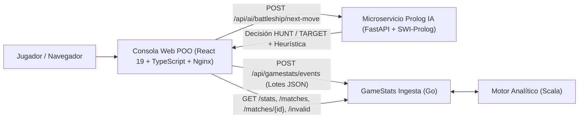

# GameConsole

**Consola Web de Videojuegos Orientada a Objetos con Motor Lógico en SWI-Prolog e Integración a GameStats**

[](https://react.dev/)
[](https://www.typescriptlang.org/)
[](https://www.swi-prolog.org/)
[](https://fastapi.tiangolo.com/)
[](https://www.docker.com/)
[](https://nginx.org/)
[](./docker-compose.yml)

**Curso:** Lenguajes de Programación — II Semestre 2026  
**Autores:** **Daniel Céspedes González** y **Santiago Pedraza Puentes**

---

## Resumen Ejecutivo

**GameConsole** es una plataforma web interactiva que integra tres videojuegos desarrollados bajo una arquitectura estrictamente orientada a objetos en TypeScript sobre React 19, un microservicio de inteligencia artificial en **SWI-Prolog** expuesto mediante **FastAPI**, ejecución concurrente multi-instancia (dock dividido y pestañas independientes) y un pipeline de telemetría en tiempo real conectado al ecosistema **GameStats (Go + Scala)**.

Cada partida genera un identificador único `matchId` (UUID v4), emite eventos tipados bajo un sobre estricto de 9 campos hacia el ingestor en **Go**, y presenta en el panel **GAMESTATS LIVE** las métricas operativas, análisis por jugador y detección de patrones complejos calculados por **Scala** (`DEADLY_STREAK` y `COMEBACK`), sin recalcular analíticas en el navegador.

---

## Demostración en Video

- **Video de demostración del sistema completo:** [https://youtu.be/a1vneCDl4tM](https://youtu.be/a1vneCDl4tM)

### Mapa Rápido de Entregables (Guía de Evaluación)

| Requisito del Proyecto | Implementación en el Repositorio |
| :--- | :--- |
| **Arquitectura POO y Consola Web** | [`BaseGame.ts`](gameconsole-web/src/core/BaseGame.ts), [`GameSessionManager.ts`](gameconsole-web/src/core/GameSessionManager.ts), [`GameRegistry.ts`](gameconsole-web/src/core/GameRegistry.ts) |
| **3 Videojuegos Funcionales (POO)** | [`SnakeGame.ts`](gameconsole-web/src/games/SnakeGame.ts), [`BattleshipGame.ts`](gameconsole-web/src/games/BattleshipGame.ts), [`HeadFootballGame.ts`](gameconsole-web/src/games/HeadFootballGame.ts) |
| **Ejecución Concurrente (Multi-Instancia / Pestañas)** | [`MultiInstanceDock.tsx`](gameconsole-web/src/components/console/MultiInstanceDock.tsx), [`App.tsx`](gameconsole-web/src/App.tsx) (`?tab=play`) |
| **Inteligencia de Juego en SWI-Prolog** | [`battleship_ai.pl`](prolog-service/battleship_ai.pl), [`solver.py`](prolog-service/solver.py), [`main.py`](prolog-service/main.py) |
| **Contrato y Envío Concurrente a GameStats** | [`contracts.ts`](gameconsole-web/src/types/contracts.ts), [`EventDispatcher.ts`](gameconsole-web/src/services/EventDispatcher.ts) |
| **Panel de Estadísticas en Tiempo Real** | [`GameStatsDashboard.tsx`](gameconsole-web/src/components/dashboard/GameStatsDashboard.tsx), [`GameStatsClient.ts`](gameconsole-web/src/services/GameStatsClient.ts) |
| **Docker, Ejecución Integrada y CI/CD** | [`docker-compose.yml`](docker-compose.yml), [`default.conf.template`](gameconsole-web/default.conf.template), [`ci.yml`](.github/workflows/ci.yml) |

---

## Arquitectura General del Sistema



### Estructura del Repositorio

```text
GameConsoleLP/
├── .github/
│   └── workflows/
│       └── ci.yml                          # Pipeline CI: build frontend, plunit + pytest, Docker & smoke tests
├── .gitignore
├── docker-compose.yml                      # Orquestación de gameconsole-web + prolog-ai-service en red gamestats-net
├── iniciar-todo.bat                        # Script de inicio local integrado para Windows
├── detener-todo.bat                        # Script de detención local para Windows
├── README.md
├── prolog-service/                         # Microservicio de Inteligencia Artificial para Battleship
│   ├── battleship_ai.pl                    # Base de conocimiento SWI-Prolog (modos HUNT y TARGET)
│   ├── solver.py                           # Puente Python -> swipl con sanitización y respaldo equivalente
│   ├── main.py                             # API REST FastAPI (:5000) con validación Pydantic y CORS
│   ├── Dockerfile                          # Imagen python:3.11-slim + swi-prolog
│   ├── requirements.txt
│   ├── requirements-dev.txt
│   └── tests/
│       ├── battleship_ai.plt               # Pruebas unitarias nativas plunit en SWI-Prolog
│       ├── test_prolog_ai.py               # Pruebas de heurísticas HUNT / TARGET
│       ├── test_api.py                     # Pruebas de integración de endpoints FastAPI
│       └── test_hardening.py               # Paridad Prolog/Python, reconstrucción de hundidos y validación
└── gameconsole-web/                        # Consola Web Arcade (React 19 + TypeScript + Tailwind + Vite)
    ├── Dockerfile                          # Build multi-stage Node 22 -> Nginx Alpine
    ├── nginx.conf                          # Configuración global de Nginx
    ├── default.conf.template               # Reverse proxy dinámico (resolver 127.0.0.11) a Go y Prolog
    ├── package.json
    ├── vite.config.ts                      # Proxies de desarrollo (/api/gamestats y /api/ai)
    └── src/
        ├── App.tsx                         # Enrutamiento principal (Lobby, Dock, Stats) y modo standalone (?tab=play)
        ├── main.tsx                        # Inicialización de EventDispatcher y registro de juegos
        ├── types/
        │   └── contracts.ts                # Contratos compartidos GameStats, videojuegos y API Prolog
        ├── core/
        │   ├── BaseGame.ts                 # Clase abstracta base (ciclo de vida, UUID v4 y emit)
        │   ├── GameSessionManager.ts       # Gestor singleton de sesiones concurrentes y multi-pestaña
        │   └── GameRegistry.ts             # Registro central de los 3 videojuegos
        ├── games/
        │   ├── SnakeGame.ts                # Motor Canvas 2D a 60 FPS con sprites pixel-art procedurales
        │   ├── BattleshipGame.ts           # Lógica por turnos (1P vs Prolog IA y 2P Local)
        │   ├── BattleshipBoard.tsx         # Interfaz naval de doble radar 10x10
        │   ├── HeadFootballGame.ts         # Motor de física 2D en Canvas con reloj de 90 segundos
        │   ├── battleship/
        │   │   ├── BattleshipAi.ts         # Cliente /api/ai/battleship/next-move con fallback táctico local
        │   │   ├── BattleshipTypes.ts      # Flota reglamentaria y conversión de coordenadas A-J / 1-10
        │   │   └── PixelNavalSprites.tsx   # Sprites navales pixel-art en SVG
        │   └── pixel/
        │       └── PixelSpriteRenderer.ts  # Caché de sprites offscreen para Canvas
        ├── services/
        │   ├── EventDispatcher.ts          # Cola FIFO no bloqueante, lotes, backoff y flush keepalive
        │   ├── GameStatsClient.ts          # Cliente HTTP tipado para Go + Scala
        │   ├── PrologClient.ts             # Verificación de salud GET /api/ai/health
        │   └── useServiceHealth.ts         # Hook periódico de salud real de Go y Prolog
        └── components/
            ├── console/                    # ArcadeLobby, ConsoleHeader, MultiInstanceDock, GameInstanceView, GameViewModal
            ├── dashboard/                  # GameStatsDashboard, MetricsCards, PatternsList, MatchDetailModal, InvalidEventsViewer
            └── pixel/                      # PixelIcon
```

---

## Diseño Orientado a Objetos y Videojuegos

### Núcleo POO (`gameconsole-web/src/core/`)

1. **`BaseGame` (`BaseGame.ts`)**: Clase abstracta que encapsula el estado y contrato común de cualquier videojuego de la consola:
   - Asigna un `matchId` único en formato UUID v4 (`crypto.randomUUID()` con respaldo UUID v4 `generateUUIDFallback()`) o reutiliza uno recibido por URL.
   - Administra los estados de sesión (`INITIALIZING`, `PLAYING`, `PAUSED`, `FINISHED`, `ABORTED`) mediante `start()`, `finish()`, `pause()`, `resume()` y `abort()`.
   - Estandariza la emisión automática de eventos `LIFECYCLE`: `PLAYER_JOINED` por cada participante, y `MATCH_STARTED` / `MATCH_FINISHED` bajo `playerId: 'SYSTEM'`.
   - Expone `emit(type, action, data, customPlayerId?)` y define los métodos abstractos `update(deltaTime)`, `render(target)` y `destroy()`, junto con los hooks `onStart()`, `onFinish()`, `onPause()` y `onResume()`.
2. **`GameSessionManager` (`GameSessionManager.ts`)**: Gestor *singleton* que mantiene un `Map<string, ActiveSession>` para ejecutar múltiples partidas simultáneas sin colisiones de estado, expone suscripciones reactivas para la interfaz y gestiona la apertura de pestañas independientes (`getStandaloneUrl()`, `openInNewTab()`, `parseUrlParams()`) y la terminación segura en eventos `pagehide`.
3. **`GameRegistry` (`GameRegistry.ts`)**: Función `registerAllGames()` que registra las factorías de `'snake'`, `'battleship'` y `'head_football'` en `GameSessionManager`.

### Catálogo de Videojuegos

| Videojuego | Clase Principal | Modos | Reglas y Mecánicas | Controles | Eventos Emitidos | Patrón / Métrica Scala |
| :--- | :--- | :--- | :--- | :--- | :--- | :--- |
| **Snake Neo** | `SnakeGame` (`SnakeGame.ts`) | `SOLO` (`1P CLASSIC`) | Tablero 25×25 a 60 FPS (`deltaTime`), incremento progresivo de velocidad (`speedBoost` hasta `2.0x`), 4 alimentos (`APPLE` +10, `CYBER_BERRY` +20, `GOLDEN_STAR` +35, `ENERGY_PILL` +50) y finalización por colisión (`WALL`, `SELF`) o tablero completo. | `W`/`A`/`S`/`D` o Flechas (`↑`/`←`/`↓`/`→`), gestos *swipe* en móvil y botón de pausa en la barra superior. | `INPUT:CHANGE_DIRECTION` (`{from, to}`), `ACTION:EAT_FOOD` (`{foodType, points, currentLength, coords}`), `STATE_UPDATE:COLLISION` (`{collisionWith, finalScore}`). | Eficiencia de movimiento y giros por alimento consumido. |
| **Battleship AI** | `BattleshipGame` (`BattleshipGame.ts`) + `BattleshipBoard.tsx` | `SINGLE_VS_AI` (1P vs SWI-Prolog) y `TWO_PLAYERS_LOCAL` (2P local por turnos) | Doble tablero 10×10 (`A`–`J`, `1`–`10`) con flota de 5 navíos (`Aircraft Carrier` 5, `Battleship` 4, `Cruiser` 3, `Submarine` 3, `Destroyer` 2). Fases `PLACEMENT_P1`, `TURN_TRANSITION` (velo de privacidad en 2P), `PLACEMENT_P2`, `COMBAT` y `FINISHED`. Otorga `+100` pts por `HIT` y `+250` adicionales por hundimiento. | Clic en celda para posicionar barcos, tecla `R` o botón `ROTATE` para alternar `HORIZONTAL`/`VERTICAL`, clic derecho para retirar un barco, `AUTO DEPLOY` / `CLEAR` y clic en el radar enemigo para disparar. | `ACTION:FIRE_SHOT` (`{coord: {row, col}, turn, result, shipSunk}`), `ACTION:AI_DECISION` (`{turn, mode, coord, heuristic}` emitido por `'CPU_AI'`). | **`DEADLY_STREAK`**: 3 o más impactos consecutivos sin fallar que culminan en el hundimiento de un barco (`shipSunk != null`). |
| **Head Football** | `HeadFootballGame` (`HeadFootballGame.ts`) | `SINGLE_VS_AI` (`1P_VS_CPU`) y `TWO_PLAYERS_LOCAL` (`2P_LOCAL`) | Campo 2D (`960×540`) con gravedad (`980 px/s²`), rebote en travesaños y postes, rotación del balón, celebraciones con confeti y reloj en cuenta regresiva de `90'` a `0'` (`FULL_TIME_90_MIN`). | **1P vs CPU:** `A`/`D` o `←`/`→` mover, `W` o `↑` saltar/cabecear, `Espacio`/`S`/`↓` tiro raso, `F` tiro bombeado.<br>**2P Local:** J1 usa `A`/`D` mover, `W` saltar, `Espacio`/`S` tiro raso, `F` bombeado; J2 usa `←`/`→` (o `J`/`L`) mover, `↑` (o `I`) saltar, `↓` (o `K`) tiro raso, `Enter`/`M` bombeado. | `ACTION:KICK` (`{shotType: 'GROUND' \| 'LOB' \| 'HEADER', ballSpeed, power}`), `STATE_UPDATE:GOAL` (`{scorerId, minute, currentScore}`). | **`COMEBACK`**: remontar una desventaja de 2 o más goles registrada en `currentScore` antes de finalizar el partido. |

---

## Inteligencia de Juego en SWI-Prolog

El razonamiento de la IA de Battleship reside en `prolog-service/battleship_ai.pl` y se expone mediante un servicio REST en FastAPI (`prolog-service/main.py` y `prolog-service/solver.py`).

### Base de Conocimiento (`battleship_ai.pl`)

El módulo `battleship_ai` exporta los predicados `solve_move/9`, `target_move/8`, `hunt_move/8`, `ship_fits/6`, `is_shot/3`, `is_blocked_for_placement/3`, `is_active_hit/3` y `sunk_cells/2`, alternando entre dos estrategias:

1. **Modo `TARGET` (`target_move/8`)** — se activa cuando existen impactos activos (`is_active_hit/3`, es decir, celdas `HIT` que no pertenecen a barcos ya hundidos):
   - **Desambiguación de barcos hundidos (`sunk_cells/2`)**: Dado que el cliente etiqueta `shipSunk` únicamente en el disparo final del hundimiento, reconstruye el segmento recto de longitud exacta (`ship_length/2`) formado por impactos previos no reclamados, evitando confundir barcos adyacentes.
   - **Búsqueda colineal (`find_line_target`)**: Si detecta dos o más impactos activos contiguos en fila o columna, dispara en los extremos libres (`TARGET_LINE_HORIZONTAL_EXTREME` o `TARGET_LINE_VERTICAL_EXTREME`).
   - **Expansión ortogonal (`find_orthogonal_target`)**: Ante impactos aislados, evalúa vecinos cardinales N/S/E/O (`TARGET_ORTHOGONAL_NEIGHBOR`); en dificultades `tactical` y `hard` prioriza celdas donde aún quepa el barco restante más pequeño (`ship_fits_s/7`).
2. **Modo `HUNT` (`hunt_move/8`)** — se ejecuta cuando no hay impactos activos pendientes:
   - **Paridad de tablero + ajuste mínimo (`HUNT_PARITY_FIT`)**: Filtra celdas no disparadas que cumplen `(R + C) mod 2 =:= 0` y donde puede ubicarse horizontal o verticalmente el barco restante más corto (`ship_fits_s/7`). En `tactical` y `hard` selecciona la celda más cercana al centro mediante distancia Manhattan (`select_best_candidate`).
   - **Búsqueda relajada y respaldo**: Si la paridad se agota, intenta cualquier celda válida donde quepa el barco (`HUNT_ANY_FIT`) o cualquier casilla libre (`HUNT_FALLBACK_UNSHOT`).

### Servicio FastAPI y Resiliencia (`main.py`, `solver.py`, `BattleshipAi.ts`)

- **Endpoints expuestos**:
  - `POST /api/ai/battleship/next-move` (y alias `/next-move`): recibe `matchId`, `difficulty` (`easy` | `tactical` | `hard`), `boardDimensions`, `shotsHistory` y `remainingShipsLengths`, y retorna `{ decision: { row, col }, mode, heuristic, inferenceTimeMs }`.
  - `GET /health` (y alias `/api/ai/health`): informa el estado del servicio y el motor activo (`SWI-Prolog`).
- **Seguridad y endurecimiento**: `sanitize_request` valida rangos, resultados permitidos y nombres de barco (`^[A-Za-z0-9 _.-]{1,40}$`), mientras `_pl_atom` escapa cualquier átomo antes de invocar el subproceso `swipl` (con *timeout* de `3.0 s`).
- **Tolerancia a fallos**: `solver.py` implementa un motor equivalente en Python puro (`_solve_python_fallback`) por si `swipl` no estuviera disponible en un entorno de desarrollo, y el frontend (`BattleshipAi.ts`) aplica un *timeout* de `2000 ms` con respaldo táctico local si el microservicio está fuera de línea.

---

## Ejecución en Paralelo y Telemetría GameStats

### Concurrencia Multi-Instancia y Multi-Pestaña

- **Dock Multi-Instancia (`MultiInstanceDock.tsx`)**: Permite mantener varias partidas en ejecución simultánea dentro de la misma ventana con vistas `auto`, `single`, `split` (50/50) y `grid`, controles globales de pausa/reanudación/cierre y aislamiento estricto de teclado por foco (`data-game-viewport`).
- **Pestañas Independientes (`?tab=play&game=...`)**: Cada botón de ventana externa crea una sesión autónoma en una nueva pestaña mediante `GameSessionManager.openInNewTab()`, generando su propio `matchId` UUID v4 sin interferir con el resto de sesiones activas.

### Despachador No Bloqueante (`EventDispatcher.ts`)

Para no afectar el bucle de 60 FPS ni la capacidad de respuesta de la interfaz:
- **Cola FIFO y procesamiento por lotes**: Encola eventos hasta `maxQueueSize = 5000` y los envía en arreglos JSON hacia `POST /api/gamestats/events` (`maxBatchSize = 25`, intervalo base `flushIntervalMs = 1000`).
- **Sanitización estricta**: `sanitizeEnvelope()` restringe cada evento exactamente a los 9 campos reconocidos por el esquema de Go (`DisallowUnknownFields`): `eventId`, `timestamp`, `gameId`, `gameVersion`, `matchId`, `playerId`, `type`, `action` y `data`.
- **Reintentos con *backoff* exponencial**: Ante fallos de red o HTTP distinto de `200`/`202`, el lote se reinserta al frente de la cola (`unshift`) preservando el orden cronológico exacto y reintenta con espera exponencial más *jitter* (`baseRetryDelayMs = 1000`, tope `maxRetryDelayMs = 30000`). Go y Scala deduplican eventos mediante `eventId`.
- **Entrega garantizada al finalizar o cerrar**: Al emitir `LIFECYCLE:MATCH_FINISHED`, o ante eventos `pagehide` / `beforeunload` (`flushOnExit()`), el despachador ejecuta un vaciado urgente con `fetch(..., { keepalive: true })` respetando el límite del navegador (`KEEPALIVE_MAX_CHARS = 60000` caracteres, ~64 KB).

**Ejemplo de sobre canónico enviado a `POST /api/gamestats/events`:**

```json
{
  "eventId": "f47ac10b-58cc-4372-a567-0e02b2c3d479",
  "timestamp": "2026-11-20T21:15:00.000Z",
  "gameId": "battleship",
  "gameVersion": "1.0.0",
  "matchId": "9b1deb4d-3b7d-4bad-9bdd-2b0d7b3dcb6d",
  "playerId": "Player1",
  "type": "ACTION",
  "action": "FIRE_SHOT",
  "data": { "coord": { "row": "D", "col": 5 }, "turn": 4, "result": "HIT", "shipSunk": null }
}
```

### Panel `GAMESTATS LIVE` (`GameStatsDashboard.tsx` + `GameStatsClient.ts`)

Consume directamente las respuestas de **GameStats (Go + Scala)** sin recalcular métricas en el cliente:
- `GET /stats` (vía `/api/gamestats/stats`): Contadores globales (`receivedEvents`, `validEvents`, `invalidEvents`, `batchesDispatched`, `matchesCompleted`, `activeMatches`, `scalaCalls`, `scalaErrors`) y telemetría de runtime de Go (`goroutines`, `heapAllocBytes`, `heapSysBytes`, `numGC`, `uptime`).
- `GET /matches`: Tabla clasificatoria con filtros por juego, estado, patrón y búsqueda por `matchId`.
- `GET /matches/{id}`: Desempaqueta `AnalysisOutput.matches[0]` (`MatchReport` generado por Scala) mostrando métricas por jugador, distribuciones, métricas cruzadas y medallas de patrones detectados (`DEADLY_STREAK`, `COMEBACK`).
- `GET /invalid`: Auditoría de eventos rechazados con su JSON crudo y motivo de descarte.
- `GET /health` y `GET /api/ai/health` (`useServiceHealth.ts`): Indicadores en vivo del estado de Go y del microservicio SWI-Prolog.

---

## Instalación, Ejecución Integrada, Pruebas y CI/CD

### Requisitos Previos

- **Opción Docker (recomendada):** Docker y Docker Compose v2, junto con el stack **GameStats (Go + Scala)** conectado a la red externa `gamestats-net`.
- **Opción Local:** Node.js 22+, Python 3.11+ y SWI-Prolog (`swipl` en el `PATH`).

### Opción 1: Ejecución Integrada con Docker Compose

1. **Levantar GameStats primero (crea la red `gamestats-net` y expone Go en `:8080`):**
   ```bash
   cd ../GameStats
   docker compose up --build -d --wait
   ```
   *(Si se desea probar GameConsole de forma aislada sin GameStats activo, crear la red manualmente con `docker network create gamestats-net`.)*

2. **Levantar GameConsole y el Microservicio SWI-Prolog:**
   ```bash
   cd GameConsoleLP
   docker compose up --build -d
   ```
   Si el contenedor de ingestión Go en `gamestats-net` tiene un nombre distinto al valor por defecto (`ingestion-go:8080`), puede indicarse mediante `GAMESTATS_UPSTREAM`:
   ```bash
   GAMESTATS_UPSTREAM=<host>:8080 docker compose up --build -d
   ```
   Nginx (`gameconsole-web/default.conf.template`) resuelve `GAMESTATS_UPSTREAM` y `PROLOG_UPSTREAM` (`prolog-ai-service:5000`) dinámicamente en cada petición usando `resolver 127.0.0.11`, por lo que la consola arranca aunque alguno de los servicios externos esté apagado (devolviendo `503 JSON` limpio en ese caso).

3. **Puntos de acceso:**
   - **Consola Web:** `http://localhost:3000` (configurable con `FRONTEND_PORT`)
   - **Prolog AI (Salud):** `http://localhost:5000/health` (configurable con `PROLOG_PORT`)
   - **GameStats Go (Salud):** `http://localhost:8080/health`

4. **Detener los servicios:**
   ```bash
   docker compose down
   ```

### Opción 2: Ejecución en Desarrollo Local

1. **Microservicio Prolog IA (`:5000`):**
   ```bash
   cd prolog-service
   pip install -r requirements.txt
   uvicorn main:app --host 0.0.0.0 --port 5000 --reload
   ```

2. **Consola Web Vite (`:3000`):**
   ```bash
   cd gameconsole-web
   npm install
   npm run dev
   ```
   `vite.config.ts` levanta el servidor en el puerto `3000` con proxies automáticos para `/api/gamestats` (`http://localhost:8080`) y `/api/ai` (`http://localhost:5000`), devolviendo `503 JSON` si alguno de los servicios no está iniciado.

3. **Scripts de conveniencia en Windows:**
   - `iniciar-todo.bat`: Inicia el servicio Prolog en `:5000`, instala dependencias de frontend si faltan, levanta Vite en `:3000` (y opcionalmente inicia `..\P1\docker-compose.yml` si existe en el directorio hermano).
   - `detener-todo.bat`: Cierra los procesos escuchando en los puertos `3000` y `5000`, y detiene los contenedores de `..\P1\docker-compose.yml` si corresponde.

### Pruebas Automatizadas

- **Pruebas unitarias en SWI-Prolog (`plunit`):**
  ```bash
  cd prolog-service
  swipl -q -g run_tests -t halt tests/battleship_ai.plt
  ```
- **Pruebas de API, endurecimiento y paridad (`pytest`):**
  ```bash
  cd prolog-service
  pip install -r requirements-dev.txt
  pytest tests/ -v
  ```
- **Verificación de tipos TypeScript y compilación de producción:**
  ```bash
  cd gameconsole-web
  npm ci
  npm run build
  ```

### Integración Continua (CI/CD)

El flujo definido en `.github/workflows/ci.yml` valida automáticamente cada `push` y `pull_request` sobre `main`, `master` y `develop` mediante tres trabajos:
1. **`frontend-build`**: Instala dependencias con Node.js 22 (`npm ci`) y ejecuta `tsc -b && vite build` (`npm run build`).
2. **`prolog-service-test`**: Instala `swi-prolog` y `curl`, ejecuta la suite `plunit` (`tests/battleship_ai.plt`) y corre `pytest tests/ -v` verificando tanto los endpoints FastAPI como la paridad nativa con `swipl` y la sanitización contra inyección.
3. **`docker-build`**: Depende de los dos trabajos anteriores; construye las imágenes de `prolog-service` y `gameconsole-web`, valida `docker compose -f docker-compose.yml config --quiet`, ejecuta un *smoke test* real contra `/health` y `POST /api/ai/battleship/next-move`, y verifica `nginx -t` en el contenedor web sin dependencias activas.
